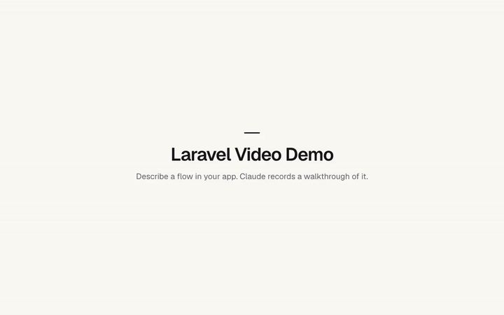
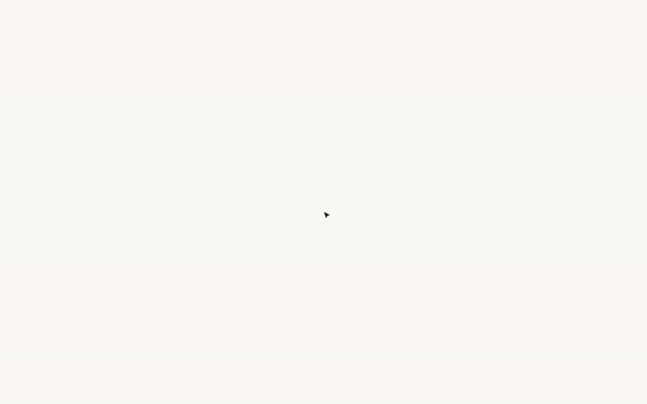

# Laravel Video Demos

[](https://packagist.org/packages/ogunsakin01/laravel-video-demos)
[](https://github.com/ogunsakin01/laravel-video-demos/actions/workflows/tests.yml)
[](https://packagist.org/packages/ogunsakin01/laravel-video-demos)
[](composer.json)
[](composer.json)
[](LICENSE.md)

Describe a flow in your Laravel app and get a recorded how-to video of it. An AI model (Claude by default, or OpenAI, Gemini, a local model and others) reads your app's code and plans the walkthrough. Playwright then records it in a real browser against your local copy of the app, with a cursor, captions and title cards, and plays it back at twice the speed so it feels snappy. You choose the length, the style (from step-by-step tutorials to short ads with animated line art) and the screens (desktop, TV, tablet, mobile), and you see the cost before anything is spent.

Videos are made on your machine and published to any Laravel disk. Your production app shows them in a ready-made help library, or inside your own pages with a Blade component.

```bash
composer require ogunsakin01/laravel-video-demos
php artisan video-demo:install
php artisan migrate
```

See [Installation](#installation) for the `.env` settings and the queue worker.

## See it

These tours were recorded by the package itself, from the demo app in [`workbench/`](workbench), in the "Promo ad" style. GitHub doesn't play videos stored in a repository, so the previews below are GIFs of the same videos; the links under them are the full MP4s.

### The studio, where you make videos

[](docs/studio-tour.mp4)

[Full studio tour (MP4, about a minute)](https://raw.githubusercontent.com/ogunsakin01/laravel-video-demos/main/docs/studio-tour.mp4)

### The library, where your users watch them

| Desktop | Mobile |
| --- | --- |
| [](docs/library-tour.mp4) | [](docs/library-tour-mobile.mp4) |

[Full library tour (MP4)](https://raw.githubusercontent.com/ogunsakin01/laravel-video-demos/main/docs/library-tour.mp4) · [Mobile version (MP4)](https://raw.githubusercontent.com/ogunsakin01/laravel-video-demos/main/docs/library-tour-mobile.mp4)

The videos in the demo library all play one sample clip, recorded from the demo app's "Post a job" page. The demo app answers "Complete with AI" with a fixed reply, so the tours could be recorded without an API key.

## How it works

1. **You describe the video** in the studio: a few words are enough, and **Complete with AI** turns them into a full description with a title, start page and length. Pick a length, a style and the screens to record.
2. **The AI reads your code.** The planner gives the model your route list and read-only access to the folders you allow (by default `app`, `routes`, `resources/views`, `resources/js`, `lang`), never `.env`, and with anything that looks like a secret hidden. It writes a step-by-step plan: go to a page, click a button, type into a field, show a caption.
3. **Playwright records the plan** against your local app, once per screen you chose. A step can be limited to some screens, such as opening the menu on mobile, and can reach into iframes, such as embedded card fields.
4. **If a step fails,** the model gets the error and the page's accessibility tree, fixes the plan, and the recorder tries again.
5. **ffmpeg encodes** each recording to MP4 with a poster image, at twice the recorded speed.
6. **You watch it and publish it.** The video and its versions are copied to your storage disk and listed in a manifest file that your production app reads.

The plan is stored with the video. After your app's look changes, `php artisan video-demo:refresh` records every published video again from its plan, at no AI cost.

## Requirements

- PHP 8.3+ and Laravel 12 or 13
- Node.js 18+ and ffmpeg on the machine where you make videos, not in production (`brew install ffmpeg` on a Mac, `apt install ffmpeg` on Ubuntu)
- An [Anthropic API key](https://console.anthropic.com/), or another provider through [Prism](#ai-providers)

## Installation

```bash
composer require ogunsakin01/laravel-video-demos
php artisan video-demo:install   # publishes the config, installs Playwright and Chromium
php artisan migrate
```

Add to `.env` on your machine:

```dotenv
ANTHROPIC_API_KEY=sk-ant-...
# The user the recorder signs in as, by id or email
VIDEO_DEMO_LOGIN_AS=demo@example.com
# Where your local app is served, if not APP_URL
VIDEO_DEMO_BASE_URL=https://myapp.test
```

Start a queue worker and open the studio at `/video-demo/studio`:

```bash
php artisan queue:work --timeout=1800
```

## The studio

The studio is where videos are made. It is only registered when `APP_ENV` is `local` (or `VIDEO_DEMO_STUDIO=true`), and never in production unless you set `studio.allow_in_production`. Its routes, including the signed sign-in link the recorder uses, do not exist when it is off.

- **New video**: describe the flow, or use **Complete with AI**. Choose the length (a target: captions and pauses stretch or shrink to fit), the versions to record, a style, the model and the effort. The estimated cost updates as you change them.
- **Video page**: watch each version, read the plan, see the actual cost and progress, publish or unpublish, record the same plan again (free), or ask the AI for a new plan.
- **Styles**: how the AI writes each video (its "direction") and how cards and captions look: light or dark, accent colour, captions at the top or bottom, pace, and **art**. With abstract art, title cards get line art that draws itself on and drifts, and the words rise into place, like an ad. The defaults are Clean walkthrough, Quick tip, Detailed tutorial, Product showcase and **Promo ad**; they come from `config/video-demo.php` and are copied into the database the first time. Add and edit your own on this page.

On a developer's machine the studio is open. Anywhere else it is enabled (a staging server, say), only users your `viewVideoDemoStudio` gate allows can use it, and without that gate it is closed:

```php
Gate::define('viewVideoDemoStudio', fn ($user) => $user->isAdmin());
```
- **Requested by users**: searches in your library that found nothing. Click one to start a video.

## From the command line

Everything the studio does is also a command, so scripts and AI agents can make videos too. Add `--json` for output a program can read.

```bash
# Waits for the video, printing an estimated cost first; exits non-zero if it fails
php artisan video-demo:generate "How a recruiter posts a job, from the jobs page to a live listing" \
    --length=60 --style=clean --devices=desktop,mobile

# An ad-style video, published to the library when it's ready
php artisan video-demo:generate "Show off posting a job" --style=ad --publish

php artisan video-demo:list
php artisan video-demo:publish post-a-job          # or --unpublish
php artisan video-demo:refresh                     # re-record published videos after UI changes, no AI cost
```

`video-demo:generate` also takes `--title`, `--model`, `--effort`, `--start=/path`, `--private` and `--queue` (queue it and return straight away).

## The library

Your users watch videos at `/help/videos` (public) and `/admin/videos` (private videos too, behind `auth`). Both prefixes, their middleware and their domains are in the config. The private library uses Laravel's `auth` middleware, which sends signed-out visitors to your app's `login` route; if your app signs people in another way, change `library.private.middleware`. The library reads the published manifest, so production needs only the storage disk, not the studio's database.

When a search finds nothing, users can ask for a video. Requests are stored in production. To see them in your local studio, set the same `VIDEO_DEMO_REQUESTS_TOKEN` in both environments and `VIDEO_DEMO_PRODUCTION_URL` locally.

### In your own pages

```blade
{{-- Plays the version that suits the viewer's screen --}}
<x-video-demo::player slug="post-a-job" />

{{-- Always the mobile version --}}
<x-video-demo::player slug="post-a-job" device="mobile" />

{{-- A search box that opens the library --}}
<x-video-demo::search placeholder="How do I…" />
```

To restyle the library pages, publish the views:

```bash
php artisan vendor:publish --tag=video-demo-views
```

## Publishing to production

Videos are made locally but watched in production, so both need to reach the same files. Use a shared disk such as S3 or R2:

```dotenv
VIDEO_DEMO_DISK=s3
```

Private videos get temporary links on disks that support them. On a public disk, anyone with a private video's address can still open it, so use a private bucket for private videos.

## Versions for each screen

| Version | Size | Notes |
| --- | --- | --- |
| Desktop | 1280×800 | On by default |
| TV | 1920×1080 | |
| Tablet | 820×1180 | Touch: taps instead of a cursor |
| Mobile | 390×844 | Touch, with the page's mobile layout |

The AI writes one plan for all of them. Each extra version only adds recording time on your machine. Sizes and defaults are in the `devices` and `default_devices` config.

### Speed

Videos play at twice the speed they were recorded, which makes clicks, typing and page changes snappy. Captions, title cards and pauses are held twice as long while recording, so they still stay up long enough to read. Change it with `VIDEO_DEMO_SPEED` (1 for real time).

If your app shows videos, set `VIDEO_DEMO_BROWSER_CHANNEL=chrome` to record with installed Chrome: Playwright's own Chromium can't play MP4.

## What it costs

Recording and encoding run on your machine and cost nothing. Each app owner pays their AI provider for their own use, with their own key.

The studio shows an estimate before you generate, and each video records what it actually cost, from the token counts the API returns. Estimates from the package's estimator, for an app with about 80 routes:

| Model, effort | 30 seconds | 1 minute | 2 minutes |
| --- | --- | --- | --- |
| Claude Opus 5.5, high | ~$0.54 | ~$0.63 | ~$0.90 |
| Claude Opus 5.5, medium | ~$0.38 | ~$0.45 | ~$0.66 |
| Claude Sonnet 5.5, high | ~$0.28 | ~$0.33 | ~$0.47 |
| Claude Haiku 5.5, high | ~$0.01 | ~$0.02 | ~$0.02 |

These are estimates, not measurements yet: compare them with the actual costs your videos show. "Complete with AI" costs about a cent. Generation stops if a video passes `limits.max_cost_per_video` ($2 by default). Prices are in the config; update them if your provider's change. A model without prices still works, but shows its cost as unknown.

## Configuration

Everything is in [`config/video-demo.php`](config/video-demo.php), with comments. The settings you are most likely to change:

| Setting | What it does |
| --- | --- |
| `ai.model`, `ai.effort` | Defaults for new videos |
| `ai.models` | The models offered, their provider and prices |
| `ai.code.paths`, `ai.code.deny` | What the AI may read |
| `ai.code.redact`, `ai.code.redact_patterns` | Hiding secrets before code is sent |
| `ai.notes` | Anything the AI should know that the code doesn't say, such as your sample data or test card numbers |
| `recorder.login_as` | The user the recorder signs in as |
| `styles` | The styles offered at first |
| `devices`, `default_devices` | Screen sizes, and which are switched on |
| `recorder.speed` | How much faster videos play than they were recorded |
| `studio.gate` | Who may use the studio outside local |
| `limits` | Cost, request and repair limits per video |
| `ui.accent`, `ui.logo`, `ui.font_url` | The look of the studio and library |

## AI providers

Claude, through the official Anthropic SDK, is the default and gets the most out of the package: prompt caching (each request pays the cheap cached price for the conversation so far), effort control, strict schemas and fallbacks when a request is declined.

Other providers go through [Prism](https://github.com/prism-php/prism): OpenAI, Gemini, Mistral, DeepSeek, Groq, xAI, OpenRouter, and local models with Ollama.

```bash
composer require prism-php/prism:^0.100
php artisan vendor:publish --tag=prism-config   # then set your provider's key in config/prism.php
```

Then add the model to `ai.models` in `config/video-demo.php`, with its provider and, for cost estimates, its prices:

```php
'models' => [
    // ...the Claude models
    'your-model-name' => ['label' => 'My model', 'provider' => 'openai', 'input' => 1.25, 'output' => 10.00],
    'qwen3-coder' => ['label' => 'Qwen3 Coder (local)', 'provider' => 'ollama', 'input' => 0, 'output' => 0],
],
```

The planner reads code and calls tools many times per video, so weaker models write plans that fail more often and need more repairs. Effort only applies to Claude.

## Payments and third-party services

- **Embedded fields**, such as Stripe Elements or PayPal buttons, sit in iframes. Plan steps can target them, and when a step fails the model is shown each iframe and what's inside it.
- **Hosted pages on another site**, such as Stripe Checkout, are reached by clicking through from your app.
- **Test mode only.** Put the provider's test card numbers or test accounts in `ai.notes` (for Stripe, `4242 4242 4242 4242`). Never use real payment details.
- **Things that arrive later**, such as a payment webhook, only work if your local app receives them, for example with `stripe listen --forward-to` your local URL. The plan's `wait` step then waits for the result.
- **Can't be automated:** CAPTCHAs, "Sign in with Google" and similar logins, codes sent by SMS, and email links. Sign the recorder in directly with `recorder.login_as`, or turn these off locally.

## Security

- **The studio** and the recorder's sign-in link only exist where the studio is enabled, and outside local only users your gate allows can use it.
- **Your code goes to your AI provider.** The model can only read the folders in `ai.code.paths`, never files matching `ai.code.deny`, and paths outside them, including `../` tricks, are refused. Anything that looks like a secret (API keys, tokens, private keys, long passwords in quotes) is replaced with `[redacted: …]` before it is sent, in code and in the pages shown when a step fails. Add your own patterns with `ai.code.redact_patterns`.
- **Prompt injection.** Text in your code, data or pages could try to give the model instructions. The model can only read the allowed folders and write plans, but plans run in a real browser as the recorder's user, so record against a disposable local database with sample data, never a copy of production.
- **Personal data.** Videos show whatever the screen shows, so use sample data.
- **Private videos** on a public disk can be opened by anyone who has the address; use a private bucket.
- **Your API key** stays in your local `.env` and is never needed in production.

Please report security problems privately; see [SECURITY.md](SECURITY.md).

## For AI agents

- **[Laravel Boost](https://laravel.com/docs/boost):** the package ships Boost guidelines, so coding agents in your app know how to make, publish and embed videos. Run `php artisan boost:install` after installing the package and choose it from the list.
- **Commands with JSON output:** an agent can run `video-demo:generate … --json`, read the result, fix what failed and run it again.
- **[llms.txt](llms.txt):** a short summary of the package for AI models.
- **[AGENTS.md](AGENTS.md):** instructions for agents working on the package itself.

## Developing the package

```bash
composer install
composer test
```

Two tests record real videos and are skipped unless Playwright is available:

```bash
VIDEO_DEMO_TEST_NODE_MODULES=/path/to/node_modules composer test
```

The demo app in `workbench/` has sample videos, styles and requests:

```bash
composer serve   # builds the demo data and serves it on port 8123
```

The tour videos above are plain plans in `workbench/tours`, recorded with the package's own recorder:

```bash
vendor/bin/testbench demo:record-tours --url=http://127.0.0.1:8123
```

## Changelog

See [CHANGELOG.md](CHANGELOG.md) for what changed in each release.

## Contributing

Bug reports, ideas and pull requests are welcome. See [CONTRIBUTING.md](CONTRIBUTING.md) for how to set up the package and its demo app, and please follow the [code of conduct](CODE_OF_CONDUCT.md).

## Credits

- [Damilola Ogunsakin](https://github.com/ogunsakin01)
- [All contributors](https://github.com/ogunsakin01/laravel-video-demos/graphs/contributors)

## License

MIT. See [LICENSE.md](LICENSE.md).
